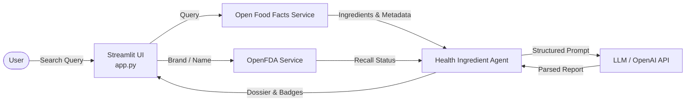

# Health Ingredient Agent 🥗

[-yellow.svg)](STATUS.md)
[](https://www.python.org/)
[](https://streamlit.io/)
[]()

> **Health Ingredient Agent** is an interactive health transparency tool that audits packaged food products, checks official OpenFDA manufacturer recall records, and uses LLMs to translate complex chemical ingredients into simple, 10-year-old-level explanations.

For full architectural status, audit metrics, and completion breakdown, see [STATUS.md](STATUS.md).

---

## ⚡ Features

### ✅ Working Today
- **Food Product Search:** Search packaged foods by name using the [Open Food Facts API](https://world.openfoodfacts.org/).
- **Regulatory Recall Check:** Cross-references product and brand names against live [OpenFDA Enforcement](https://open.fda.gov/apis/food/enforcement/) records (Safe 🟢 / Warning 🟡 / Danger 🔴 badges).
- **Tripartite Ingredient Classification:** Classifies detected ingredients into three clear categories: *Natural*, *Processed*, and *Synthetic*.
- **Accessible Plain-Language Summary:** Translates technical chemical terminology into an easy-to-understand breakdown ("Explain like I'm 10").
- **Health Profile Filtering:** Customizes alerts for specific conditions: Diabetes, Hypertension, Celiac/Gluten intolerance, Pregnancy, and Pediatric diets.
- **Exportable Audit Dossiers:** One-click download of the inspection report in clean Markdown format.

### 🚧 In Progress & Planned
- **Barcode / UPC Lookup:** Core API method exists in backend; frontend scanning and input integration is in progress.
- **Pharmaceutical & Drug Analysis:** Drug recall checks are active; full drug label lookup via OpenFDA is in development.
- **Nutritional Macro & Ultraprocessed Alerts:** Direct extraction of sugar, sodium, and NOVA classifications.
- **Multi-Provider LLM Resilience:** Fallback parsing for non-OpenAI / self-hosted models.
- **Modular Architecture:** Migrating monolithic UI code from `app.py` into `src/ui/`.

---

## 🏗️ Architecture Flow



---

## 📦 Installation & Setup

1. **Clone the repository:**
   ```bash
   git clone https://github.com/Obumbratio/health-ingredient-agent.git
   cd health-ingredient-agent
   ```

2. **Create and activate a virtual environment:**
   ```bash
   python -m venv venv
   # On Windows:
   .\venv\Scripts\activate
   # On macOS/Linux:
   source venv/bin/activate
   ```

3. **Install dependencies:**
   ```bash
   pip install -r requirements.txt
   ```

4. **Configure environment variables:**
   ```bash
   cp .env.example .env
   ```
   Add your API keys to `.env`:
   ```ini
   LLM_API_KEY="your_openai_or_compatible_key"
   OPENAI_MODEL="gpt-4o-mini"
   OPENFDA_API_KEY="" # Optional (increases OpenFDA rate limits)
   ```

5. **Run the application:**
   ```bash
   streamlit run app.py
   ```

---

## 🗺️ Roadmap (Next Steps)

Prioritized from the [STATUS.md](STATUS.md) audit:

- [ ] **Critical:** Prevent unhandled 403s on non-OpenAI endpoints & display user-friendly error banners on API failure.
- [ ] **Critical:** Fix module resolution so test scripts run without manual `PYTHONPATH` exports.
- [ ] **Important:** Implement pharmaceutical/medication ingredient lookup via OpenFDA drug labels.
- [ ] **Important:** Extract sugar, sodium, and NOVA ultraprocessed metrics from Open Food Facts.
- [ ] **Important:** Expose barcode search in the Streamlit UI.
- [ ] **Important:** Populate modular components in `src/ui/` and write automated tests (`pytest`).
- [ ] **Polish:** Add PDF/HTML report export, complete `.env.example`, and set up Docker + CI/CD.

---

## 📄 License
Developed for GatewayHacks 2026. Distributed under the MIT License.
